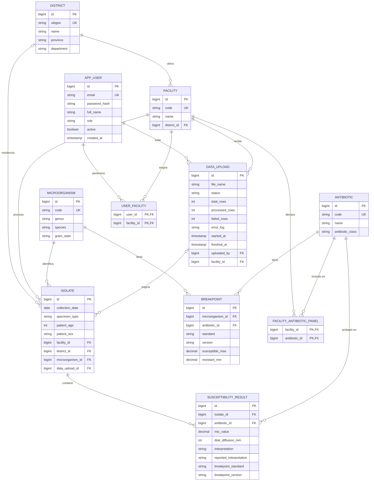

# Atlas RAM

**Plataforma de antibiogramas acumulados para una terapia antibiótica empírica informada**

| | |
|---|---|
| **Curso** | CS 2031 Desarrollo Basado en Plataforma |
| **Universidad** | Universidad de Ingeniería y Tecnología (UTEC), 2026-2 |
| **Integrantes** | Álvaro Felipe Quispe Carrillo · Joaquim Alexander Carrión Díaz · Fabian Isaias Sanchez Zedano · Adriano Alonso Cosme Salazar |
| **API desplegada** | `https://3-85-201-152.sslip.io/api/v1` |

---

## Proyecto 2: aplicación completa

| Componente | URL | Repositorio |
|---|---|---|
| **API REST** (Spring Boot) | https://3-85-201-152.sslip.io/api/v1 | este repositorio |
| **Web** (React) | https://atlas-ram-web.vercel.app | [`atlas-ram-web`](https://github.com/alvaroquispec-code/atlas-ram-web) |
| **Móvil** (React Native + Expo) | https://github.com/alvaroquispec-code/atlas-ram-mobile/releases/latest/download/atlas-ram.apk | [`atlas-ram-mobile`](https://github.com/alvaroquispec-code/atlas-ram-mobile) |

**Cuentas de demostración.** Cualquiera puede crear una cuenta desde *Registrarse*; el servidor siempre le asigna el rol de solo lectura (`PUBLIC_VIEWER`). Las cuentas con rol de laboratorio, epidemiología, farmacia o administración del despliegue público tienen una contraseña privada que se entrega a los evaluadores a pedido. En un entorno local, el seed crea esas mismas cuentas con la contraseña indicada en [`db/seed/CALIBRACION.md`](db/seed/CALIBRACION.md).

### Arquitectura de despliegue

```
 Web (Vercel, HTTPS) ──┐
                       ├──► Caddy :443 (HTTPS, Let's Encrypt) ──► Spring Boot :8080 ──► RDS PostgreSQL 16
 Móvil (APK, HTTPS) ───┘          EC2 t3.micro · Amazon Linux 2023                      (solo acepta al SG del servidor)
                                                   │
                                                   └──► Nominatim (OpenStreetMap), llamado desde el móvil
```

| Pieza | Configuración |
|---|---|
| HTTPS | Caddy como proxy inverso con certificado automático de Let's Encrypt sobre `3-85-201-152.sslip.io` |
| CORS | `CORS_ALLOWED_ORIGINS` en el servidor, con el dominio de Vercel y `localhost` para desarrollo |
| Secretos | JWT y credenciales de la base solo en variables de entorno del servidor (`/etc/atlasram.env`), fuera del repositorio |
| Frontends | `VITE_API_URL` (Vercel) y `EXPO_PUBLIC_API_URL` (`eas.json`): ninguna URL está escrita en el código |

### Integrantes y participación

El porcentaje indica cuánto cumplió cada integrante de sus responsabilidades en cada fase (100 % = cumplimiento completo).

| Integrante | Principales aportes | Fase 1 (API) | Fase 2 (web, móvil y despliegue) |
|---|---|:---:|:---:|
| Álvaro Felipe Quispe Carrillo | Modelo de dominio y lógica de la API; despliegue completo (AWS EC2, RDS, HTTPS con Caddy, Vercel, EAS); web: panel de resistencia, aislamientos, usuarios y catálogo; base de la app móvil | 100 % | 100 % |
| Joaquim Alexander Carrión Díaz | Fase 1: autenticación JWT con refresh tokens y autorización por rol (#5). Fase 2: web, con login y registro, cliente API con interceptores y rutas protegidas | 100 % | 100 % |
| Adriano Alonso Cosme Salazar | Fase 1: ingesta asíncrona de CSV, eventos de dominio y notificaciones (#8). Fase 2: app móvil, con escáner QR, registro de aislamientos y publicación del APK con EAS | 100 % | 100 % |
| Fabian Isaias Sanchez Zedano | Fase 1: excepciones propias, manejo global de errores y endpoints de la API (#6). No participó en la fase 2 | 100 % | 0 % |

---|---|
| Álvaro Quispe | Backend, despliegue (AWS, HTTPS, Vercel), web (bloques 2 y 3) y base de la app móvil |
| Joaquim Carrión | Web: autenticación, cliente API y rutas protegidas |
| Adriano Cosme | Móvil: escáner QR, registro de aislamientos y publicación con EAS |

---

## Índice

- [Proyecto 2: aplicación completa](#proyecto-2-aplicación-completa)
- [Introducción](#introducción)
- [Identificación del problema](#identificación-del-problema)
- [Descripción de la solución](#descripción-de-la-solución)
- [Modelo de entidades](#modelo-de-entidades)
- [Manejo de errores](#manejo-de-errores)
- [Medidas de seguridad](#medidas-de-seguridad)
- [Eventos y asincronía](#eventos-y-asincronía)
- [Despliegue](#despliegue)
- [Ejecución local](#ejecución-local)
- [GitHub y gestión del proyecto](#github-y-gestión-del-proyecto)
- [Conclusión](#conclusión)
- [Apéndices](#apéndices)

---

## Introducción

### Contexto

La resistencia antimicrobiana es una de las principales amenazas de salud pública según la Organización Mundial de la Salud. Cuando un paciente llega con una infección grave, el médico no puede esperar los dos o tres días que tarda el cultivo: tiene que elegir un antibiótico de inmediato. Esa elección, llamada **terapia empírica**, se apoya en el **antibiograma acumulado**, un resumen de qué porcentaje de las bacterias aisladas en una institución o región resiste a cada antibiótico.

En el Perú, los laboratorios generan estos datos a diario, pero quedan dispersos en hojas de cálculo y exportaciones de WHONET que rara vez se consolidan. Los antibiogramas acumulados, cuando existen, se publican una vez al año y en PDF.

### Objetivos

- Centralizar los resultados de susceptibilidad de múltiples laboratorios en un solo sistema.
- Interpretar cada concentración mínima inhibitoria (CIM) contra puntos de corte versionados, de forma trazable.
- Calcular antibiogramas acumulados filtrables por microorganismo, distrito y período, respetando el umbral mínimo de la guía CLSI M39.
- Procesar cargas masivas de forma asíncrona y alertar cuando una combinación supera un umbral de resistencia.
- Proteger el acceso según el rol de cada usuario.

---

## Identificación del problema

### Descripción

Un laboratorio clínico reporta, para cada aislamiento bacteriano, la CIM de cada antibiótico probado y su interpretación: sensible, intermedio o resistente. Esa interpretación depende de un **punto de corte** publicado por comités como el CLSI, que se revisa cada año. En 2019, por ejemplo, el CLSI redujo el punto de corte de ciprofloxacino para enterobacterias: resultados que antes eran sensibles pasaron a ser resistentes sin que la bacteria cambiara.

Si un sistema solo guarda la interpretación final, pierde la capacidad de explicar por qué un resultado dice lo que dice, y una serie histórica deja de ser comparable. Si además los datos no se agregan, el médico decide a ciegas.

### Justificación

Una terapia empírica mal elegida retrasa el tratamiento efectivo y selecciona más resistencia. Contar con datos locales, actualizados y trazables es la base de cualquier programa de optimización de antimicrobianos. El problema no es la falta de datos, sino su fragmentación.

---

## Descripción de la solución

### Funcionalidades implementadas

**Carga masiva asíncrona.** Un técnico sube un archivo CSV con los resultados de su laboratorio. El servidor responde `202 Accepted` de inmediato y procesa el archivo en segundo plano. Cada fila con errores se registra sin abortar la carga completa, y el usuario consulta el progreso en cualquier momento.

**Interpretación trazable.** Cada resultado conserva la CIM cruda, la interpretación que reportó el laboratorio y la que calcula el sistema, junto con el estándar y la versión del punto de corte aplicado. Esto permite reinterpretar el histórico cuando cambie la norma.

**Antibiograma acumulado.** Sigue la guía CLSI M39: cuenta solo el **primer aislamiento de cada paciente y especie** en el período (los cultivos repetidos de un mismo paciente suelen ser los más resistentes e inflarían el porcentaje), informa el porcentaje de sensibles y de resistentes con su **intervalo de confianza de Wilson al 95 %**, y omite las combinaciones con menos de 30 aislamientos, lo que además reduce el riesgo de reidentificar pacientes en grupos pequeños. Cada fila dice cuántos aislamientos repetidos se excluyeron y qué porcentaje tenía paciente identificado.

**Hospitales de referencia.** Un distrito pequeño, por ejemplo sin hospital propio, rara vez reúne 30 resultados por combinación. En vez de mostrar un porcentaje poco confiable, `GET /antibiogram/referral` identifica los tres hospitales donde más se atienden los pacientes de ese distrito y devuelve el antibiograma de esos hospitales.

**Estimación con muestras pequeñas.** El mapa por distrito agrega, junto al porcentaje de siempre, una estimación con *pooling* parcial (Bayes empírico beta-binomial): la media y la dispersión de la red se estiman con todos los distritos (método de momentos de Kleinman) y cada distrito recibe la media posterior con su intervalo de credibilidad al 95 %. Con pocos aislamientos la estimación se acerca a la media de la red; con muchos respeta el dato local. Es un dato adicional: no reemplaza la regla de 30 de CLSI M39.

**Resistencia intrínseca.** La vista previa de la interpretación reconoce los pares que CLSI M100 (apéndice B) declara de resistencia natural, por ejemplo *E. coli* frente a vancomicina o *P. aeruginosa* frente a ceftriaxona, y avisa que no se prueban ni se informan.

**Reporte PROA en PDF.** `GET /reports/proa?facilityId=&from=&to=` genera el reporte del establecimiento para el Comité de Optimización de Antimicrobianos (NTS 184-MINSA/DIGEMID-2022): antibiograma acumulado CLSI M39 con intervalos de Wilson, resaltado de sensibilidades menores de 80 % y alertas de brote activas. Solo contiene agregados.

**Datos reales publicados.** En el Perú no hay datos abiertos a nivel de aislamiento, así que los datos reales disponibles son agregados publicados. La migración V17 carga la Tabla 1 del estudio VIRAPERU (Krapp et al., *Am J Trop Med Hyg* 2023, licencia CC BY: 15 hospitales públicos de 12 regiones, hemocultivos 2017-2019) en tablas propias (`published_source`, `published_result`), separadas de los aislamientos. `GET /antibiogram/published` devuelve cada fila con su intervalo de Wilson y, al lado, la resistencia que calcula Atlas RAM para el mismo par y el mismo tipo de muestra. La V19 suma una fuente de 2024: *E. coli* urinaria del Hospital III José Cayetano Heredia de EsSalud en Piura (Rodriguez-Saldaña et al., *Interdiscip Perspect Infect Dis* 2026, CC BY 4.0, 350 pacientes). El artículo informa porcentajes, así que el conteo de resistentes se reconstruye como porcentaje × 350.

**Búsqueda de aislamientos.** El listado acepta filtros opcionales y combinables (establecimiento, microorganismo y tipo de muestra), construidos con JPA Specifications, además de paginación y orden.

**Alertas de brote.** Tras cada carga, el sistema compara las últimas 4 semanas de cada establecimiento con su propia línea base de 12 meses mediante una prueba binomial exacta, agrupa la señal por clase de antibiótico y mantiene una sola alerta activa por combinación; si la carga que la originó se revierte, la alerta se retira con el motivo.

**Inventario de antibióticos.** La farmacia registra ingresos por lote, consumos (que salen primero del lote que vence antes, FEFO) y bajas. Para cada ítem, `GET /logistics/facilities/{id}/stock` calcula:

- los indicadores de disponibilidad del SISMED (CPMA, meses de existencia y estado: desabastecido, substock, normostock, sobrestock o sin rotación);
- el patrón de demanda (clasificación de Syntetos-Boylan-Croston) y el pronóstico que le corresponde (SES, SBA o TSB);
- el pedido sugerido de una política de revisión periódica (R, S). S cubre la demanda de los R + L días con el nivel de servicio del ítem (99 % si es vital o Reserve AWaRe), y se estima con el bootstrap de Willemain, sin suponer normalidad;
- la clase ABC-VEN, las unidades que vencerán sin usarse al ritmo actual y una señal de **presión de brote**. La señal aparece cuando hay una alerta activa en el establecimiento y un fármaco de escalamiento tiene poca cobertura.

`GET /logistics/facilities/{id}/ddd` da el consumo en DDD por 100 camas-día por grupo AWaRe.

**Procedencia de los datos.** Cada carga y cada aislamiento se marcan como reales (laboratorio) o sintéticos (prueba y demostración), y toda estadística se puede filtrar por procedencia. Los establecimientos guardan además su código único de IPRESS del RENIPRESS de SUSALUD (8 dígitos).

**Control de acceso por rol.** Administradores, técnicos de laboratorio, epidemiólogos, farmacéuticos y usuarios públicos tienen permisos distintos.

### Tecnologías utilizadas

| Categoría | Tecnología |
|---|---|
| Lenguaje | Java 21 |
| Framework | Spring Boot 3.5.6 (Web, Data JPA, Security, Validation, Mail) |
| Persistencia | Hibernate 6.6, PostgreSQL 16, Flyway (migraciones) |
| Autenticación | JWT con jjwt 0.12.6, BCrypt |
| Utilidades | Lombok |
| Infraestructura | Docker Compose (desarrollo), AWS EC2 y RDS (producción) |
| Integración continua | GitHub Actions |

### Arquitectura

```mermaid
flowchart LR
    C[Cliente] -->|HTTP + JWT| F[JwtAuthenticationFilter]
    F --> CT[Controllers]
    CT --> S[Services]
    S --> R[Repositories]
    R --> DB[(PostgreSQL)]
    S -->|publica| E[Eventos]
    E -->|@Async| L[Listeners]
    L --> M[MailService]
```

El código sigue una arquitectura en capas: los controladores reciben la petición y delegan en los servicios, que contienen la lógica de negocio y acceden a los datos mediante repositorios de Spring Data. Las entidades nunca se exponen: toda entrada y salida pasa por DTOs y mappers.

---

## Modelo de entidades



### Descripción de entidades

| Entidad | Propósito |
|---|---|
| `District` | Distritos con su ubigeo del INEI. |
| `Facility` | Establecimientos de salud, cada uno en un distrito. |
| `Microorganism` | Catálogo de microorganismos con código WHONET y tinción de Gram. |
| `Antibiotic` | Catálogo de antibióticos con código WHONET y familia. |
| `User` | Usuarios con correo, contraseña cifrada y rol. |
| `Isolate` | Un aislamiento bacteriano: fecha, tipo de muestra, microorganismo y establecimiento. |
| `SusceptibilityResult` | La CIM de un antibiótico sobre un aislamiento y su interpretación. |
| `Breakpoint` | Puntos de corte por microorganismo, antibiótico, estándar y versión. |
| `DataUpload` | Registro de cada carga masiva con su estado y errores. |

Se usan los cuatro tipos de relación de JPA. Todos los `@ManyToOne` son `LAZY` para evitar consultas N+1. La relación entre `Isolate` y `SusceptibilityResult` es bidireccional con `cascade = ALL` y `orphanRemoval`, porque un resultado no existe fuera de su aislamiento. Las relaciones hacia catálogos son unidireccionales, porque nadie necesita cargar todos los aislamientos de un distrito.

### Decisiones de diseño

- **Sin identificador de paciente.** El modelo no guarda nombre ni documento: la anonimización está en el diseño, no en una promesa.
- **CIM en `BigDecimal`.** La comparación contra puntos de corte exige aritmética exacta.
- **Puntos de corte versionados y por sitio de infección.** La restricción única combina microorganismo, antibiótico, estándar, versión y sitio (`ANY`, `MENINGITIS`, `NON_MENINGITIS`), de modo que conviven varias versiones del CLSI y los dos umbrales de *S. pneumoniae* frente a ceftriaxona y cefepima. Una CIM en líquido cefalorraquídeo se interpreta con el de meningitis; cualquier otra muestra, con el de no meningitis. En el antibiograma acumulado esos pares salen en dos filas, (meningitis) y (no meningitis), cada una con su punto de corte aplicado a la CIM de todos los primeros aislamientos.
- **Restricciones con nombre explícito.** `uk_isolate_antibiotic` impide duplicar un antibiótico en un aislamiento, y su nombre es el contrato con el manejador de errores.
- **Migraciones con Flyway.** El esquema vive en `src/main/resources/db/migration` como SQL versionado (`V1__esquema_inicial.sql`, `V2__…`), y Hibernate corre con `ddl-auto=validate`: si una entidad no coincide con la base, la aplicación no arranca. La base de producción, creada antes con `ddl-auto=update`, se adoptó con un *baseline* en la versión 1, sin volver a ejecutar V1.
- **Distrito de agregación.** La procedencia del paciente es opcional. Si falta, un campo calculado usa el distrito del establecimiento, sin copiarlo al guardar, para no confundir un dato real con uno inferido.

---

## Manejo de errores

La API centraliza el manejo de errores en un `@ControllerAdvice`, de modo que ninguna excepción llega al cliente como una traza de Java. Toda respuesta de error comparte el mismo formato:

```json
{
  "timestamp": "2026-09-22T08:30:00Z",
  "status": 404,
  "error": "Not Found",
  "message": "Establecimiento no encontrado: 99",
  "path": "/api/v1/facilities/99"
}
```

Se definieron ocho excepciones personalizadas, y el manejador traduce cada una a un código HTTP:

| Excepción | Código | Cuándo ocurre |
|---|---|---|
| `ResourceNotFoundException` | 404 | el recurso solicitado no existe |
| `DuplicateResourceException` | 409 | se intenta crear un registro que ya existe |
| `UploadNotRevertableException` | 409 | reservada para revertir cargas, que aún no tiene endpoint |
| `InvalidCredentialsException` | 401 | correo o contraseña incorrectos |
| `InvalidTokenException` | 401 | token ausente, expirado o mal firmado |
| `BusinessRuleException` | 422 | la petición es válida pero viola una regla del dominio |
| `BreakpointNotFoundException` | 422 | no hay punto de corte para interpretar un resultado |
| `InvalidCsvFormatException` | 400 | el archivo de carga no tiene el formato esperado |

El manejador también captura las excepciones propias de Spring, para que un error del cliente nunca llegue como `500`:

| Excepción de Spring | Código |
|---|---|
| `MethodArgumentNotValidException`, `HttpMessageNotReadableException`, parámetro faltante o con tipo inválido | 400 |
| `AccessDeniedException` (por ejemplo, un técnico que registra en un establecimiento que no tiene asignado) | 403 |
| `NoResourceFoundException` (ruta inexistente) | 404 |
| `HttpRequestMethodNotSupportedException` | 405 |
| `DataIntegrityViolationException` (se viola una restricción de la base) | 409 |
| `MaxUploadSizeExceededException` (archivo de más de 20 MB) | 413 |
| `HttpMediaTypeNotSupportedException` | 415 |

`AccessDeniedException` necesita su propio manejador porque `@PreAuthorize` la lanza dentro del controlador: la atrapa el `@ControllerAdvice` y no el `AccessDeniedHandler` de Spring Security. Cualquier otra excepción responde `500` con un mensaje genérico y se registra en el log, sin exponer la traza al cliente.

Manejar los errores de forma global garantiza respuestas consistentes para el cliente, evita filtrar detalles internos y concentra la lógica en un solo lugar.

---

## Medidas de seguridad

### Seguridad de datos

- **Autenticación sin estado con JWT.** El login entrega un token de acceso de una hora y un token de renovación. Un filtro valida el token en cada petición y carga el usuario en el contexto de seguridad.
- **Contraseñas con BCrypt.** Nunca se almacena ni se devuelve la contraseña en texto plano.
- **Sesiones revocables.** Un JWT firmado vale hasta que vence, así que cada token lleva la versión de sesión del usuario (claim `ver`, columna `app_user.token_version`) y el filtro lo rechaza si no coincide. Cambiar la contraseña, que el administrador la restablezca, desactivar la cuenta o pedir «cerrar sesión en todos los dispositivos» incrementa la versión: los tokens anteriores, incluidos los de renovación de 7 días, dejan de valer en la siguiente petición. Un token presentado e inválido recibe 401 aun en los endpoints públicos, y la web y la app verifican la sesión al volver a primer plano y cada 30 s: si se cerró desde otro dispositivo, vuelven al login sin esperar a que el usuario abra una pantalla protegida.
- **Cambio de contraseña con la contraseña actual.** `PUT /auth/me/password` exige la contraseña vigente, de modo que un token robado no basta para tomar la cuenta. Responde 422 (no 401) si es incorrecta, para que el cliente no lo confunda con una sesión vencida.
- **Cuatro roles.** `ADMIN`, `LAB_TECHNICIAN`, `EPIDEMIOLOGIST` y `PUBLIC_VIEWER`, guardados en la base y en el token. Los métodos sensibles se protegen con `@PreAuthorize`.
- **Registro con permisos mínimos.** Todo usuario nuevo se crea como `PUBLIC_VIEWER`; solo un administrador puede elevar su rol.
- **Control por establecimiento.** Un técnico de laboratorio solo puede registrar aislamientos y cargar archivos de los establecimientos que tiene asignados. Lo verifica `@PreAuthorize` con un evaluador propio sobre la relación `user_facility`.
- **Verificación de correo y aprobación automática.** Al registrarse llega un enlace de un solo uso (se guarda solo su SHA-256; vence en 24 h; máximo uno por minuto). Si el correo verificado es del dominio institucional del establecimiento (p. ej. `@essalud.gob.pe`), la solicitud de acceso profesional se aprueba sola; si no, la aprueba el jefe de ese establecimiento.
- **Jefes por establecimiento.** Tabla `facility_manager`: cada hospital aprueba a su propio personal. Un jefe solo ve y decide las solicitudes de sus establecimientos y nadie aprueba la suya.
- **Registro de establecimientos con RUC e IPRESS.** El RUC se valida con el dígito verificador de SUNAT y el sector (público o privado) lo decide el padrón RENIPRESS de SUSALUD, no lo que declara la clínica: una privada que dice ser pública queda como privada. Un hospital público con correo verificado `.gob.pe` y nombre que coincide con RENIPRESS se aprueba solo. El padrón de Lima y Callao (15 834 IPRESS, corte del 30-10-2026, datos abiertos de SUSALUD) se carga en V21, junto con el dominio de correo de cada hospital: MINSA no usa un dominio común, cada hospital tiene el suyo.
- **Colegiatura cifrada en la base.** `access_request.registration_number` se guarda con AES-256-GCM (`FieldCipher`, clave `FIELD_ENCRYPTION_KEY` o derivada de `PATIENT_KEY_SECRET`); las filas antiguas en texto se leen igual.
- **Límite también para cuentas públicas.** Registrarse es gratis, así que una cuenta `PUBLIC_VIEWER` cuenta igual que un visitante anónimo (por cuenta, no por IP): «me registro y descargo todo» no salta el límite.
- **Secretos fuera del código.** La clave JWT y las credenciales se leen de variables de entorno. El archivo `.env` está excluido del repositorio.
- **Datos anonimizados por diseño**, como se explicó en el modelo.

### Prevención de vulnerabilidades

- **Inyección SQL:** todas las consultas usan JPA con parámetros enlazados; no se concatena SQL.
- **XSS:** la API solo devuelve JSON y no renderiza HTML con datos de usuario.
- **CSRF:** la protección se desactiva de forma deliberada porque la API es sin estado y no usa cookies de sesión.
- **CORS:** configurado en Spring Security para controlar qué orígenes pueden llamar a la API desde un navegador.
- **Validación de entrada:** Bean Validation en todos los DTOs de entrada.
- **Fuerza bruta en el inicio de sesión (OWASP API2/API4):** límite de intentos **fallidos** en una ventana de 15 minutos, por correo (5) y por IP (30), con respuesta `429` y `Retry-After`. Un inicio de sesión correcto nunca se bloquea por esto. Se apaga con `RATE_LIMIT_ENABLED=false`.
- **Anti-scraping de la API pública (OWASP API4):** quien consulta sin sesión tiene un límite de 600 peticiones por minuto por IP (`429` con `Retry-After`). Las peticiones con sesión no cuentan, porque son usuarios identificados y auditados. Se ajusta con `API_RATE_LIMIT_PER_MINUTE` (0 lo apaga). Con varias instancias, el límite pasaría a Redis o a AWS WAF.
- **Detrás de CloudFront:** si la API se sirve por CloudFront, la IP del usuario se toma de `CloudFront-Viewer-Address`, pero solo cuando la petición trae el secreto de origen `X-Origin-Verify` (`CLOUDFRONT_ORIGIN_SECRET`). Así nadie que llame directo al servidor puede inventarse una IP para saltarse los límites.
- **Caché de agregados (rendimiento):** las consultas públicas más caras (antibiograma, mapa por distrito, tendencias, WISCA y datos publicados) se guardan en memoria con Caffeine: máximo 500 entradas por consulta y vencimiento a los 2 minutos. Cualquier escritura correcta vacía la caché, y la carga de CSV la vacía de nuevo al terminar en segundo plano, así que lo cargado aparece al instante. Se apaga con `CACHE_TYPE=none`.
- **Consentimiento de datos personales (Ley 29733):** quien se registra solo debe aceptar la política de tratamiento de datos (la web la publica en `/privacidad`); se guarda la versión aceptada y la fecha (`app_user.data_policy_version`, `data_policy_accepted_at`, V18).
- **Acceso profesional sin administración manual del rol:** un profesional de la salud se registra con su colegio (CMP, CTMP, CBP o CQFP), su número de colegiatura, su establecimiento y el rol que necesita. El sistema comprueba el formato, que el establecimiento exista (y su código RENIPRESS), que el rol sea clínico (nunca ADMIN) y que corresponda a la profesión, y crea una solicitud (`access_request`). Los colegios no ofrecen una API abierta, así que un administrador confirma la colegiatura en el buscador público del colegio y aprueba con un clic: el usuario recibe el rol, queda asignado a su establecimiento y sus sesiones anteriores se cierran. `GET /access-requests`, `POST /access-requests/{id}/approve|reject` (ADMIN); `GET|POST /access-requests/mine` (cualquier usuario).
- **Registro de auditoría:** la tabla `audit_log` guarda quién hizo cada escritura y cada lectura de datos individuales (aislamientos, FHIR, usuarios), con la ruta sin parámetros, el código de respuesta y la IP. Nunca datos del paciente. `GET /audit-log` (solo ADMIN).

**Limitación conocida:** los tokens de renovación no se persisten, así que no pueden revocarse antes de expirar (ver issue #4).

---

## Eventos y asincronía

La ingesta de un archivo con miles de filas puede tardar. Si se procesara dentro de la petición HTTP, el cliente quedaría bloqueado y la conexión podría expirar. Por eso el endpoint de carga responde `202 Accepted` y delega el trabajo.

| Evento | Se publica cuando | Efecto |
|---|---|---|
| `UploadCompletedEvent` | una carga termina | correo al usuario con el resumen |
| `UploadFailedEvent` | una carga falla | correo al usuario con el motivo |
| `ResistanceAlertEvent` | una combinación supera el umbral | correo a epidemiología |

Los listeners usan `@TransactionalEventListener`, que espera a que la transacción se confirme antes de ejecutarse: así no se notifica una carga que luego se revierte. Los eventos llevan solo datos planos, nunca entidades, porque el listener corre en otro hilo fuera de la transacción.

Se configuran dos `ThreadPoolTaskExecutor` separados: uno para la ingesta y otro para las notificaciones. Si compartieran hilos, una carga larga retrasaría todos los correos.

---

## Despliegue

La API está desplegada en AWS en `https://3-85-201-152.sslip.io/api/v1`.

| Componente | Configuración |
|---|---|
| Aplicación | EC2 `t3.micro`, Amazon Linux 2023, Java 21, servicio `systemd` |
| Base de datos | RDS PostgreSQL 16, `db.t4g.micro`, conexión cifrada |
| Red | La base solo acepta conexiones desde el grupo de seguridad del servidor |
| HTTPS | Caddy como proxy inverso delante de Spring Boot, con certificado de Let's Encrypt |
| Configuración | Variables de entorno en el servidor, fuera del repositorio |
| Acceso al servidor | Sin SSH desde internet (solo puertos 80 y 443 abiertos): terminal por AWS Systems Manager (Session Manager) |

Prueba rápida: `GET https://3-85-201-152.sslip.io/api/v1/districts`

### Despliegue continuo

Cada push a `main` que pasa el CI se despliega solo (`.github/workflows/deploy.yml`):

1. GitHub Actions corre las pruebas (unitarias y de integración contra PostgreSQL real).
2. El job de despliegue pide a AWS una **credencial temporal por OIDC**: no hay llaves de AWS guardadas en GitHub. El rol solo puede subir a `releases/` del bucket y ordenar comandos a esta instancia, y solo lo puede asumir el entorno `production` de este repositorio, identificado por su ID numérico inmutable (formato de *subject* inmutable de GitHub): aunque el repositorio se borre y otro se cree con el mismo nombre, no hereda el acceso.
3. El jar se guarda en S3 con el hash del commit, así cada versión desplegada es trazable y se puede volver a ella.
4. **AWS Systems Manager** ejecuta `scripts/deploy-remote.sh` en el servidor, sin puerto 22 abierto:
   respalda la base con `pg_dump`, cambia el jar, reinicia el servicio y prueba la salud durante 3 minutos.
   Si la prueba falla, vuelve solo al jar anterior y el workflow termina en rojo.
5. El workflow comprueba la API pública por HTTPS.

Las migraciones de Flyway no se deshacen, así que se escriben compatibles hacia atrás (solo agregan tablas o columnas): el jar anterior sigue funcionando con la base ya migrada. Antes de una migración con riesgo se ensaya sobre una copia del respaldo de producción.

Políticas de IAM en `infra/aws/`.

---

## Ejecución local

**Requisitos:** Java 21, Docker Desktop.

```bash
git clone https://github.com/alvaroquispec-code/atlas-ram-backend.git
cd atlas-ram-backend
cp .env.example .env          # completar contraseñas y JWT_SECRET
docker compose up -d          # PostgreSQL en el puerto 5433
export JWT_SECRET=...         # Spring no lee el .env: la variable debe estar en el entorno
export PATIENT_KEY_SECRET=... # openssl rand -base64 32
./mvnw spring-boot:run        # Flyway crea las tablas (db/migration)
docker cp db/seed/data.sql atlasram-db:/tmp/data.sql
docker exec atlasram-db psql -U atlasram -d atlasram -f /tmp/data.sql
# opcional: inventario sintético de demostración (HNHU)
docker cp db/seed/inventario_demo.sql atlasram-db:/tmp/inventario_demo.sql
docker exec atlasram-db psql -U atlasram -d atlasram -f /tmp/inventario_demo.sql
```

### Pruebas

`./mvnw test` corre dos niveles de pruebas:

- **Unitarias** (con Mockito): estadística (Wilson, Cochran-Armitage, WISCA, bootstrap de Willemain), lectura de CSV y WHONET, reglas de carga, inventario y control de acceso.
- **De integración** contra PostgreSQL real (`src/test/java/.../integration`):
  - los triggers del distrito de agregación;
  - las restricciones de la base (estados, procedencia, RENIPRESS, saldo de lotes, archivo duplicado, código de aislamiento único);
  - las consultas SQL del antibiograma CLSI M39, la tendencia y el WISCA;
  - el kardex FEFO;
  - dos consumos simultáneos del mismo lote, para comprobar que nunca dejan stock negativo.

  Corren sobre un PostgreSQL 16 desechable que levanta **Testcontainers** (Docker tiene que estar encendido), al que Flyway le aplica todas las migraciones desde cero. Así las pruebas nunca tocan la base de desarrollo y el CI prueba en cada push que un despliegue limpio funcione.

**Prueba de humo.** `scripts/smoke.ps1` llama a los endpoints principales (antibiograma, tendencia, WISCA, alertas, cargas, inventario, normas, puntos de corte por sitio y estratificación por UCI) contra un servidor en marcha y avisa si alguno falla: `powershell -ExecutionPolicy Bypass -File .\scripts\smoke.ps1 -BaseUrl <url de la API>`. Contra `localhost` usa la contraseña del seed; contra cualquier otro servidor la toma de la variable de entorno `ATLAS_SMOKE_PASSWORD` o la pide por teclado sin mostrarla, para que ninguna contraseña real quede escrita en el repositorio.

### Variables de entorno

| Variable | Descripción |
|---|---|
| `SPRING_DATASOURCE_URL` | URL JDBC de la base |
| `SPRING_DATASOURCE_USERNAME` | usuario de la base |
| `SPRING_DATASOURCE_PASSWORD` | contraseña de la base |
| `JWT_SECRET` | clave de firma en base64, mínimo 64 bytes |
| `JWT_EXPIRATION_MS` | vigencia del token de acceso |
| `PATIENT_KEY_SECRET` | secreto en base64 (mínimo 32 bytes) para seudonimizar el identificador de paciente con HMAC-SHA256 |
| `JPA_DDL_AUTO` | modo de Hibernate sobre el esquema; por defecto `validate` (el esquema lo maneja Flyway) |
| `MAIL_ENABLED` | activa el envío real de correos |
| `RATE_LIMIT_ENABLED` | límite de intentos fallidos de inicio de sesión (por defecto `true`) |
| `MAIL_HOST`, `MAIL_USERNAME`, `MAIL_PASSWORD`, `MAIL_FROM` | servidor SMTP (también para el correo de verificación) |
| `APP_WEB_URL` | dirección de la web para el enlace de verificación |
| `FIELD_ENCRYPTION_KEY` | clave AES-256 en base64 para cifrar columnas; si falta, se deriva de `PATIENT_KEY_SECRET` |

### Formato del CSV de carga

UTF-8, separado por comas o por punto y coma (Excel en español), con cabecera. Las columnas se reconocen
por su nombre, en cualquier orden; las que el sistema no usa se ignoran. Una fila = un antibiótico de un aislamiento.

| Columna | Obligatoria | Ejemplo | Notas |
|---|---|---|---|
| `fecha_toma` | sí | `2026-08-20` o `20/08/2026` | no puede ser futura |
| `tipo_muestra` | sí | `URINE`, `ORINA`, `SANGRE`, `LCR` | |
| `codigo_microorganismo` | sí | `eco` | códigos WHONET |
| `codigo_antibiotico` | sí | `MEM` | códigos WHONET |
| `cim` | * | `<=0.25`, `>=16`, `0,5`, `4/76` | con calificador; coma decimal aceptada |
| `halo_mm` | * | `19` | diámetro del halo en mm (difusión en disco); también `halo`, `diametro_halo`, `disco_mm` |
| `interpretacion_laboratorio` | * | `S`, `I`, `R`, `RESISTENTE` | se usa si ni la CIM ni el halo bastan para interpretar |
| `id_paciente` | recomendada | historia clínica | se guarda solo un seudónimo HMAC; permite la regla del primer aislamiento (CLSI M39) |
| `id_aislamiento` | recomendada | número de muestra | evita mezclar pacientes y registrar dos veces el mismo aislamiento |
| `codigo_establecimiento` | no | `HNCH` | si viene, debe ser el de la carga |
| `edad`, `sexo`, `ubigeo_residencia` | no | `47`, `F`, `150135` | |
| `servicio` | recomendada | `UCI`, `HOSPITALIZACION`, `EMERGENCIA`, `CONSULTA_EXTERNA` | permite el antibiograma y el WISCA por servicio (CLSI M39 recomienda uno propio para UCI); también `tipo_servicio`, `ubicacion`, `location_type` |

\* Cada fila necesita una CIM o un halo interpretables, o la interpretación del laboratorio.

**Variables mínimas obligatorias del INS.** El INS exige sexo, edad, servicio y tipo de localización para enviar los datos a WHONET-INS. En el registro manual de un paciente (`POST /isolates`, formulario web y móvil, que incluye su antibiograma) los tres campos son obligatorios y se validan en el servidor. En una carga CSV o WHONET se aceptan vacíos para no perder el antibiograma, y `GET /uploads/{id}` informa el porcentaje de aislamientos de la carga que los trae (`completeness`).

**Exportación de WHONET.** También se acepta el archivo que exporta WHONET (una fila por aislamiento y una columna por antibiótico, como `MEM_NM`, `CIP_EE` o `AMP_ND10`). Se reconoce solo y se convierte al formato anterior. Las columnas del aislamiento se aceptan con su nombre técnico (`SPEC_DATE`, `SPEC_TYPE`, `ORGANISM`, `PATIENT_ID`, `SPEC_NUM`, `ISOL_NUM`, `LOC_TYPE`), en inglés o en español. Las columnas de CIM (M) y de gradiente (E) se leen como CIM. Las de disco (D) se leen como diámetro del halo en mm; si un antibiótico trae CIM y disco se guardan ambos y la interpretación usa primero la CIM. Cualquier columna puede traer S, I o R en lugar del número.

**Interpretación por disco.** Orden: CIM concluyente → halo → interpretación del laboratorio. En el disco el sentido es el contrario al de la CIM: sensible si el halo ≥ `diskSusceptibleMin`, resistente si ≤ `diskResistantMax`, intermedio entre ambos. Esos dos valores se cargan por punto de corte (`POST /breakpoints`) desde la tabla vigente de CLSI M100; el sistema no trae valores de disco precargados para no publicar puntos de corte desactualizados.

**Procedencia.** `POST /uploads` recibe `origin=REAL` o `origin=SYNTHETIC` (por defecto `SYNTHETIC`: el sistema nunca presume que un dato es real). Todas las consultas del antibiograma, la tendencia, el WISCA y el mapa aceptan `origin` para calcular solo con datos reales, y cada fila del antibiograma informa `realDataPercentage`. El seed completo es `SYNTHETIC`.

### Interoperabilidad (HL7 FHIR, LOINC y SNOMED CT)

Un hospital trabaja con varios sistemas: el equipo automatizado, uno o más sistemas de laboratorio (LIS) y el sistema hospitalario (HIS). Para que Atlas RAM pueda conversar con ellos, cada aislamiento se exporta en **HL7 FHIR R4** (`GET /fhir/isolates/{id}`, `application/fhir+json`): un `Bundle` con el informe (`DiagnosticReport`), la muestra (`Specimen`), el microorganismo identificado y una `Observation` por antibiótico.

| Dato | Estándar | Ejemplo |
|---|---|---|
| Microorganismo | SNOMED CT | *Klebsiella pneumoniae* → `56415008` |
| Prueba por CIM | LOINC | Meropenem por CIM → `6652-2` |
| Prueba por disco | LOINC | Amikacina por disco → `13-3` |
| Valor | UCUM | `>= 16 ug/mL`, `19 mm` (el comparador de la CIM se conserva) |
| Interpretación | HL7 v3 ObservationInterpretation | `S`, `I`, `R` |

Los 21 antibióticos y 8 microorganismos del catálogo tienen sus códigos, verificados uno por uno contra loinc.org y SNOMED CT International (`fhir/Terminology.java`). Un código que no esté verificado no se inventa: se envía solo el texto. La exportación no incluye ningún dato del paciente.

### Endpoints principales

Todos bajo `/api/v1`. La documentación completa está en `postman_collection.json`.

| Método | Ruta | Acceso |
|---|---|---|
| `POST` | `/auth/register` | público |
| `POST` | `/auth/login` | público |
| `PUT` | `/auth/me/password` | autenticado: cambia su contraseña (exige la actual); cierra sus otras sesiones y devuelve tokens nuevos |
| `POST` | `/auth/me/logout-all` | autenticado: cierra la sesión en todos sus dispositivos |
| `PUT` | `/users/{id}/password` | administrador: restablece la contraseña de un usuario y cierra sus sesiones |
| `GET` | `/districts`, `/microorganisms`, `/antibiotics`, `/facilities` | público |
| `GET` | `/standards` | público: edición de CLSI M100 con que se interpretan las CIM, la norma de agregación (CLSI M39) y las tablas de fenotipos esperados de EUCAST |
| `GET` | `/breakpoints/editions` | autenticado: ediciones de puntos de corte cargadas y cuál está activa |
| `POST` | `/breakpoints/reinterpret?version=&apply=` | administrador: reinterpreta las CIM y halos guardados con una edición; `apply=false` es vista previa, `apply=true` solo con la edición activa |
| `GET` | `/antibiogram?ward=` | público; `ward` (`ICU`, `INPATIENT`, `EMERGENCY`, `OUTPATIENT`) da el antibiograma estratificado de ese servicio |
| `GET` | `/antibiogram/referral?districtId=` | público: antibiograma de los hospitales donde se atienden los pacientes del distrito (los 3 que más reciben) |
| `GET` | `/auth/me/facilities` | autenticado: establecimientos donde el usuario puede registrar |
| `GET` | `/isolates?facilityId&microorganismId&specimen&page&size&sort` | autenticado (filtros opcionales y combinables) |
| `GET` | `/fhir/isolates/{id}` | técnico, epidemiólogo o administrador (de su establecimiento): el aislamiento y su antibiograma en HL7 FHIR R4 |
| `POST` | `/isolates` | técnico o administrador (de su establecimiento): registra un paciente con su antibiograma en una sola transacción (`results`: antibiótico, CIM como texto `"<=0.25"`, halo o interpretación). `patientId` opcional (solo se guarda su seudónimo HMAC) o `samePatientAsIsolateId` para otro aislamiento del mismo paciente |
| `POST` | `/isolates/{id}/results` | técnico o administrador (de su establecimiento): agrega antibióticos que llegan después, todos o ninguno; rechaza los que el aislamiento ya tiene |
| `POST` | `/uploads` | técnico o administrador |
| `GET` | `/uploads/{id}` | autenticado |
| `GET` | `/logistics/facilities/{id}/stock` | farmacéutico (su establecimiento), epidemiólogo o administrador |
| `GET` | `/logistics/facilities/{id}/ddd?from&to&bedDays` | farmacéutico (su establecimiento), epidemiólogo o administrador |
| `POST` | `/logistics/items`, `/logistics/items/{id}/receipts`, `/logistics/items/{id}/consumptions`, `/logistics/lots/{id}/write-off` | farmacéutico (su establecimiento) o administrador |
| `POST` | `/logistics/facilities/{id}/movements/import` (CSV, campo `file`) | farmacéutico (su establecimiento) o administrador |

**Importar el kardex.** La farmacia puede subir el kardex que ya lleva (exportado de su sistema o de Excel): una fila por movimiento, con columnas `fecha`, `tipo` (`INGRESO`/`ENTRADA`, `CONSUMO`/`SALIDA`/`DISPENSACION`, `BAJA`/`MERMA`), `codigo_antibiotico`, `cantidad` y, según el tipo, `lote`, `vencimiento`, `presentacion` y `nota`. Se aceptan varios nombres por columna (por ejemplo "Fecha de vencimiento" u "Observación"). Las filas se aplican por fecha y, el mismo día, primero los ingresos; cada una pasa por las mismas reglas del kardex manual (FEFO, sin stock negativo) y las que fallan se devuelven con su número de línea.
| `GET` | `/logistics/items/{id}/lots`, `/logistics/items/{id}/movements` | farmacéutico (su establecimiento), epidemiólogo o administrador |

Usuarios de prueba del seed (solo entorno local; en el despliegue público estas cuentas usan otra contraseña): `admin@atlasram.test`, contraseña `AtlasRam2026!`.

---

## GitHub y gestión del proyecto

El trabajo se dividió en cuatro módulos: dominio, seguridad, API y errores, y asincronía con despliegue. Cada integrante trabajó en ramas con prefijo `feat/`, `fix/`, `chore/` o `docs/`, que se integraron en `develop` mediante pull requests revisados por otro integrante. La rama `main` recibe solo versiones estables.

Los commits siguen la convención *Conventional Commits*. Las tareas pendientes y las limitaciones conocidas se registran como issues, organizados con labels por módulo y un milestone para la entrega de la semana 7.

GitHub Actions compila el proyecto en cada push y pull request, y verifica que no se suban archivos de secretos.

---

## Conclusión

### Logros

Atlas RAM convierte resultados dispersos de laboratorio en antibiogramas consultables, con una interpretación trazable a la versión del estándar clínico aplicado. El sistema procesa cargas masivas sin bloquear al usuario, alerta sobre resistencias elevadas y está desplegado y accesible públicamente.

### Aprendizajes clave

Aprendimos que las decisiones de modelado tienen consecuencias clínicas: guardar la CIM cruda en lugar de solo la interpretación es lo que hace posible reinterpretar datos históricos. También que la asincronía exige cuidado con las transacciones, y que coordinar cuatro módulos obliga a acordar contratos, como el nombre de una restricción, antes de escribir código.

### Trabajo futuro

- Persistir los tokens de renovación para permitir su revocación (#4).
- Validar los antibióticos reportados contra el panel declarado de cada establecimiento (#1).
- Umbrales de alerta por combinación de microorganismo y antibiótico.
- Procesamiento por lotes para archivos muy grandes.
- Reinterpretación masiva del histórico cuando se publique un nuevo estándar.

---

## Apéndices

### Datos de prueba

Los datos del seed son **sintéticos**. Los catálogos usan nomenclatura real (códigos WHONET, ubigeo del INEI), y las tasas de resistencia están calibradas con estudios peruanos publicados. No corresponden a pacientes reales. El detalle está en `db/seed/CALIBRACION.md`. El inventario de `db/seed/inventario_demo.sql` (consumos, costos y camas) también es sintético e ilustrativo; lo genera `gen_inventario_demo.py`.

### Licencia

MIT.

### Referencias

1. Clinical and Laboratory Standards Institute. *M100: Performance Standards for Antimicrobial Susceptibility Testing*.
2. Clinical and Laboratory Standards Institute. *M39: Analysis and Presentation of Cumulative Antimicrobial Susceptibility Test Data*.
3. Organización Mundial de la Salud. *Global Antimicrobial Resistance and Use Surveillance System (GLASS)*.
4. Levy-Blitchtein S, Roca I, Plasencia-Rebata S, et al. *Emergence and spread of carbapenem-resistant Acinetobacter baumannii international clones II and III in Lima, Peru*. Emerging Microbes & Infections. 2018;7(1):119. doi:10.1038/s41426-018-0127-9
5. Krapp F, Cuicapuza D, Salvatierra G, et al. *Emerging carbapenem-resistant Klebsiella pneumoniae in a tertiary care hospital in Lima, Peru*. Microbiology Spectrum. 2025;13(2). doi:10.1128/spectrum.01825-24
6. Montañez-Valverde RA, Montenegro-Idrogo JJ, Arenas-Significación FR, Vásquez-Alva R. *Infección urinaria alta comunitaria por E. coli resistente a ciprofloxacino: características asociadas en pacientes de un hospital nacional en Perú*. Anales de la Facultad de Medicina. 2015;76(4):385-391.
7. Ley N.º 29733, Ley de Protección de Datos Personales del Perú.
8. Syntetos AA, Boylan JE, Croston JD. *On the categorization of demand patterns*. Journal of the Operational Research Society. 2005;56(5):495-503.
9. Syntetos AA, Boylan JE. *The accuracy of intermittent demand estimates*. International Journal of Forecasting. 2005;21(2):303-314.
10. Teunter RH, Syntetos AA, Babai MZ. *Intermittent demand: Linking forecasting to inventory obsolescence*. European Journal of Operational Research. 2011;214(3):606-615.
11. Willemain TR, Smart CN, Schwarz HF. *A new approach to forecasting intermittent demand for service parts inventories*. International Journal of Forecasting. 2004;20(3):375-387.
12. Silver EA, Pyke DF, Thomas DJ. *Inventory and Production Management in Supply Chains*. 4.ª ed. CRC Press; 2017.
13. Management Sciences for Health. *MDS-3: Managing Access to Medicines and Health Technologies*. 2012.
14. Organización Mundial de la Salud. *AWaRe classification of antibiotics* (2023) y WHO Collaborating Centre for Drug Statistics Methodology, *ATC/DDD Index*.
